# S1 brakes, wheels and Dynamic Chassis Control (S1 8X)

**Applies to:** Audi S1 8X (3-door and Sportback, CWZA 2.0 TFSI, quattro). Much of the brake section also
fits the A1 quattro, but that car's special model uses a 5 x 112 bolt pattern and different parts. Front-wheel
drive A1s have a torsion beam rear axle and none of the DCC hardware.

The S1's running gear is not a hot A1: MacPherson struts at the front as usual, but a **multi-link rear axle with
an anti-roll bar** and **dampers with variable characteristics** on all four corners. The steering is
electro-mechanical. Several jobs below end with a diagnostic tester, so have one ready (VCDS or ODIS).

## Brake hardware: read your PR codes first

The brake codes are printed on the vehicle data sticker (spare wheel well and service book). One code is for the
front axle and one for the rear. The workshop manual does **not** say which code an S1 left the factory with, so
look at your sticker and use ETKA for parts. What the manual does give:

| | Front, 310 mm codes (1ZS, 1ZN, 1ZM) | Rear, 272 mm codes (1KF, 1KX) |
|---|---|---|
| Disc type | ventilated | solid |
| Diameter | 310 mm | 272 mm |
| Thickness new | 25 mm | 10 mm |
| Wear limit | 23 mm | 8 mm |
| Bolt circle | 5 x 100 | 5 x 100 |

- The smaller front brakes (256 mm on 1ZG, 288 mm on 1ZC) and the 230 mm rear (1KT) are for lower-powered A1s.
  The 312 mm front (1LJ) and the rear 1KS are 5 x 112 and belong to the A1 quattro special model, not the S1.
- The rear splash-plate section for 1KF/1KS/1KX is illustrated on an S1, which matches the 272 mm rear.
- Front and rear calipers slide on two guide pins in a carrier. Code 1ZN has an extra small splash plate that
  has to come off before the pads.
- Disc run-out limit is 0.06 mm, measured with the disc fitted, 10 mm in from the outer edge.
- Hairline cracks up to 10 mm long are fine. A crack right across the disc or pad means renewal, in axle pairs.

**Pad wear limit:** 9 mm front and 9 mm rear. That figure **includes** the backing plate and damper plate. The
maintenance booklet only asks you to measure the outer pad. The left front inner pad carries the wear sender.

**Rear pads:** the rear caliper piston is self-adjusting and has the handbrake lever on it, so it has to be
**screwed** back, not pushed (Audi uses tool T10165 for this). Release the handbrake first. Afterwards pump the
pedal a few times with the car standing still, then check the handbrake adjustment.

## Handbrake

A plain mechanical handbrake: a lever on the centre console, a compensator and two cables to levers on the rear
calipers (the brake manual covers no other type for the 8X). The rear brakes adjust themselves, so the cable
only needs setting after new cables, calipers or lever. Cables are renewed as a pair. Target: with the handbrake
off, each caliper lever sits no more than 1.5 mm from its stop, and both rear wheels spin freely.

## Brake fluid and bleeding

- **Fluid:** the manuals give no DOT number, only genuine Audi fluid per ETKA, always new, and nothing with
  mineral oil near it. Darker fluid with age is normal and says nothing about condition. Changes go by time (service schedule).
- **Quantities to push through on a fluid change:** about 0.20 l at each front caliper, 0.30 l at each rear and
  0.15 l at the clutch slave cylinder (the S1 is manual, so the clutch shares the reservoir).
- **Order:** front left, front right, rear left, rear right (outer screw first on a two-screw caliper).
- **ESP and the tester:** an ordinary bleed or fluid change does **not** need the tester to cycle the ABS pump.
  The manual's bleed procedure ends with a **zero calibration of brake pressure sender 1 (G201)** using the
  diagnostic tester, then a road test where ABS steps in at least once on every wheel.
- **New ABS/ESP unit (J104 with hydraulic unit N55):** on the S1 the manual shows it on the **left** of the engine bay. A
  new unit comes pre-filled. Leave its port plugs in until each pipe is ready to go on. After fitting it you
  run the tester's "Replace" guided function and a final control diagnosis, then bleed normally. After any job
  that opens the hydraulics, Audi also lists a pressure hold test (Rep. gr. 47, leak test).

**Brake roller tester (MOT):** quattro cars are fine on a single-axle tester **only** if the rollers turn the two
wheels in opposite directions, at no more than 6 km/h. Gearbox in neutral.

## Wheels and tyres

**Wheel bolts: 120 Nm.** Five bolts, 5 x 100 bolt circle, 57 mm hub bore. Clean the hub and seats, keep oil and
grease off the bolt seats, snug them in a cross pattern until the wheel sits flat, lower the car, torque in a
cross pattern, then go round once more. No impact gun.

The Wheel/Tyre Guide lists these for the S1 (section 1.7, *Audi S1 type 8X*). Every size is XL:

| Use | Rim | Offset (ET) | Tyre | Chains |
|---|---|---|---|---|
| Summer | 7.5J x 17 | 34 | 215/40 R17 87Y | no |
| Summer | 7.5J x 18 | 37.5 | 225/35 R18 87Y | no |
| Summer | 7.5J x 18 | 39.5 | 225/35 R18 87Y | no |
| Winter | 6J x 16 | 30 | 195/50 R16 88H | yes, front axle |
| Winter | 7.5J x 17 | 36 | 215/40 R17 87V | no |

- Snow chains are only approved on the **16-inch winter set**. Nothing under 16 inch is listed (on the A1 the
  guide ties 15-inch wheels to the small 1ZG/1ZC brakes). For both 18-inch offsets it points to ETKA accessories.
- A1 quattro special-model wheels (5 x 112) will not fit an S1.

## After suspension or steering work

| You did this | Then do this |
|---|---|
| Anything that changes the geometry (alignment, tie rods, subframe moved) | **Basic setting of steering angle sender G85**: tester, address 44 (power steering), guided function |
| Steering rack or steering column out and back in | G85 basic setting again |
| Rear left level sender G76 renewed, or an alignment done | **Headlight basic setting**: address 55, headlight range control J431 |
| Suspension parts renewed or refitted | Four-wheel alignment check. Most links, wheel bearing housings, track rods and subframes need one; the manual has a table (*Running gear*, Rep. gr. 44) |

- The rear is adjustable: camber on an eccentric on the upper link, toe on one on the lower link (90° either way
  from centre). At the front, toe is on the track rods and camber is only centred by sliding the subframe.
- Tighten suspension bushes and joints with the car at its **unladen ride height**, not hanging. Before you strip
  a corner, measure from the wheel centre to the arch edge so you can jack it back to that height.
- On a new car, the manual waits 1000-2000 km before an alignment check so the springs can settle.

## Dynamic Chassis Control (DCC)

**Parts** (current flow diagram *Dynamic Chassis Control, CWZA*, valid from January 2014):

- **J250**: damping control unit, behind the dash on the glove box side, on the powertrain CAN bus.
- **N336 / N337** (front left / right) and **N338 / N339** (rear left / right): the damper adjustment valves.
- **G76**: rear left level sender, between the rear subframe and lower link. It also feeds headlight range control J431.

**How it works:** each damper has an electrically controlled valve built in. J250 changes the current to each
valve and with it how firm the damper is. Each valve has a 2-pin plug wired to J250. The DCC diagram shows no
sensors of its own, so J250 takes its inputs over the CAN bus. The front-strut removal steps mention the damper
plug only under **vehicles with Audi drive select**, which is how the dampers tie in to the drive select modes.
The manuals we have don't describe the modes themselves.

**Replacing a damper:**

- Unplug the damper first. At the rear the wire goes through a grommet into the boot, behind the side trim, so
  the boot trim has to come back.
- The adjustable damper is a different part from the conventional one. Order by PR code in ETKA.
- Old dampers have to be degassed and drained before they are thrown away (*Running gear*, Rep. gr. 00, disposal).
- The manual lists **no tester calibration after a damper swap**. Bolt it up at unladen height. We would still
  read J250's fault memory afterwards and clear anything left from having it unplugged.

**Replacing J250:** the glove box comes out, and the control unit unclips from its bracket. A new unit needs the
tester's **"Replace control unit"** guided function, which also walks you through the calibration.

## Official references

- *Brake system*: Rep. gr. 00 (technical data, brake test), 45 (ABS/ESP), 46 (pads, discs, handbrake), 47 (bleeding).
- *Running gear*: Rep. gr. 42 (S1 rear dampers), 43 (damping control, level sender), 44 (alignment, G85), 48 (steering).
- *Wheel/Tyre Guide* section 1.7; *Wheels and tyres* Rep. gr. 44 (bolts); *Maintenance* Booklet 819; *Electrical system* Rep. gr. 94.

**Sources:** Audi workshop manuals for the A1/S1 8X: *Brake system* (09.2018), *Running gear, front-wheel drive and
four-wheel drive* (09.2017), *Wheel/Tyre Guide* (09.2019), *Wheels and tyres* (11.2019), *Maintenance* (11.2015 and
06.2018), *Electrical system* (07.2018), current flow diagrams for the CWZA (from 01.2014), and the A1 technical
introduction SSP 477. Facts only, written in our own words.
