# Servicing the S1 (CWZA): intervals, fluids and capacities (S1 8X)

**Applies to:** Audi S1 8X with the CWZA 2.0 TFSI (EA888 gen III, 170 kW), 6-speed manual 0A8 quattro (code PRY)
and the 0BR rear final drive with a generation V Haldex coupling. Much of the engine side also fits the 1.8 TFSI
(DAJB), which shares the same manuals. It does **not** fit the earlier A1 quattro (CDLH engine, gen IV coupling).

**First, what's missing.** The workshop manuals send you to the ELSA *maintenance tables* (or your service
booklet) for the oil grade, the oil capacity and most of the CWZA's mileage and time intervals. Our copy doesn't
include those tables. So this guide gives you the methods, the capacities and the specs that *are* printed, and
says where you have to check by VIN. Nothing below is guessed.

## How the service display works

From model year 2011 every A1, the S1 included, splits servicing into three kinds of event:

- **Oil change: flexible.** The car works out when the oil is due from how it's driven. A new car shows no oil
  figure until about 500 km. Lots of cold starts and short trips bring it forward.
- **Inspection: by distance.** These events come round at multiples of 30,000 km.
- **Time-based items.** These are due after a set time whatever the mileage, for example the brake fluid.

That is the flexible (LongLife-style) scheme, and it is the only one our manuals describe. Whether your car is
set to a fixed interval instead, and which VW oil standard goes with each, is in the maintenance table or service
booklet for your VIN. The manuals don't print the oil standard numbers.

**Resetting the service:** the manual does this with the dealer tester (special functions, reset the service
event). After the reset the car recalculates the next oil change from its own driving history. The trip and
journey memories in the cluster are a separate reset, covered in the Owner's Manual. (*Maintenance*, ch. 3.)

## Engine oil and filter

- **Grade and quantity:** maintenance table only (see above). The manual points out that the change quantity
  is not the same as the first fill at the factory.
- **Change it warm.** The S1 has a dipstick. Read it with the oil at 60 °C or more, the car level, and the
  engine stopped for a few minutes so the oil can settle. The marked zone on the stick has three bands: top band, leave it alone; middle
  band, you may add some; bottom band, you must add. Don't overfill: too much oil can damage the catalytic converter.
- **Draining:** the filter housing has its own drain valve. The workshop opens it with drain adapter T40057
  (screwed into the housing under a protective cap), then pulls the sump plug. Fit a new plug seal. A metal sump
  plug is 30 Nm. A plastic sump has a sealing plug instead, which you turn to its stop with a coin or screwdriver.
  Pumping out through the dipstick tube is also allowed, if the probe can reach the bottom of the sump.
- **Filter:** a paper element inside a housing you reach from the top, under the engine cover. The cap takes a
  32 mm socket. Cracking it open lets the housing drain into the crankcase, so give it a few minutes before you
  lift it out. Fit a new O-ring with a smear of oil. The cap goes back at 25 Nm.
- **Filling:** the filler is on the timing chain cover. Wipe the sealing face inside the neck before the cap
  goes back on. On first start, let it idle until the oil pressure lamp goes out, then rev it.

(*Maintenance*, ch. 3, engine oil, the 2.0 TFSI sections; on the filter and plug, use the "1.8/2.0 TFSI version 1"
section. *Servicing 2.0 TFSI EA888 Gen. III*, Rep. gr. 17.)

## Spark plugs

The CWZA uses the "1.8/2.0 TFSI version 1" plug procedure: undo the earth strap nut, unplug the coils, and pull
each coil with puller T10530. Plugs go in at **30 Nm** (engine manual). Before refitting, give each coil's
sealing boot a 1-2 mm bead of the approved silicone grease. New coils come pre-greased. Press the coils home by
hand only. The plug part number, gap and interval are not in our copy: get the plug by VIN in the parts catalogue.
(*Maintenance*, ch. 3; *Servicing 2.0 TFSI EA888 Gen. III*, Rep. gr. 28.)

## Air filter and pollen filter

- **Air filter** ("1.8/2.0 TFSI version 1"): the top of the airbox lifts off with its ducts. Clear leaves out of
  the box and its water drain, and drop the new element in centrally. The top must sit flush without being forced.
  Its screws are only **1.5 Nm**. If you blow the box out, cover the air mass meter first. Interval: by VIN.
- **Pollen filter:** it sits under the glove box, behind a clip-off cover, and the flow arrows point **down**.
  See [the cabin filter guide](cabin-filter-glovebox-blower.md). SSP 477 gives 30,000 km / 2 years for the
  launch A1 engines. The S1 isn't in that table, so check yours.

## Brake fluid (and the clutch)

The clutch shares the brake fluid reservoir, so it gets bled at every fluid change. The manual says to change
both at the same interval. The clutch chapter's cross-reference gives that as every 2 years. SSP 477 adds that on
a new car the first change can be at 3 years, depending on market. The fluid spec is only "genuine Audi brake
fluid, see the parts catalogue". Never reuse it, and keep it off the paint.

Roughly how much to push through each bleed point on a pressure bleeder (if a caliper has two bleeders, add them up):

| Order | Bleed point | Fluid out |
|---|---|---|
| 1 | Front left | 0.20 l |
| 2 | Front right | 0.20 l |
| 3 | Rear left | 0.30 l |
| 4 | Rear right | 0.30 l |
| 5 | Clutch slave cylinder | 0.15 l |
| | **Total, manual gearbox** | **1.15 l** |

Afterwards, the brake pedal's free travel should be a third of its stroke at most. (*Maintenance*, ch. 3, brake
fluid; *0A8 four-wheel drive*, Rep. gr. 30, bleeding the clutch.)

## Coolant

- **Which additive:** the manuals only say to use an approved one from the parts catalogue (ETKA). They don't
  name the factory G-number for the S1, so check by VIN.
- **Mixing:** the 06.2018 *Maintenance* lets you mix G12EVO, G13 and G12++ with each other, and with G11, G12 and
  G12+. **G11 and G12 must never meet.** The 11.2015 edition warned that mixing the newer types with the older ones
  can weaken corrosion protection. Don't mix unless you have to.
- **Strength:** about 40 % additive and 60 % water protects to -25 °C. A 50/50 mix protects to -36 °C. Never go
  above 55 % additive, which is about -48 °C: past that, both frost protection and cooling get worse. Use distilled
  water only. Check the strength with a refractometer. If the coolant is mixed, read the G13 scale.
- **Level:** check it cold, at the top mark of the expansion tank. Sitting above MAX is fine by design, so don't
  draw any off. Don't drive the car with the level below the top mark. (*Maintenance*, ch. 3, coolant;
  *Servicing 2.0 TFSI EA888 Gen. III*, Rep. gr. 19.)

## Gearbox, bevel box, rear final drive and Haldex

| Unit | Capacity | Oil / level |
|---|---|---|
| 0A8 gearbox (PRY) | 2.15 l (partly stripped), 2.30 l (fully stripped) | Spec in ETKA; level with the bottom of the filler hole |
| Bevel box (on the side of the gearbox) | 0.9 l, its own oil | Spec in ETKA; fill to the lip of the filler hole; new drain and filler plugs |
| Rear final drive 0BR | 0.95 l | Gear oil per ETKA; to the lip of the filler hole |
| Haldex gen V coupling | 0.85 l total, **0.70 l at a change** | Its own high-performance oil per ETKA; no additives |

- The final drive and the coupling are **separate oil circuits** with their own plugs. Fit new plugs every time.
  On the 0BR, the coupling drain plug is 38 Nm and the other three plugs are 15 Nm. The 0CR figures differ, so
  don't mix them up.
- **Haldex level check:** first read the coupling temperature with a tester (address 22, 4WD electronics). It must
  be 20-40 °C. The level is right anywhere from the filler lip down to 3 mm under it. The workshop fills it
  with charging tool VAS 6291 A.
- **Haldex filter:** the gen V parts breakdown shows no filter. (The gen IV unit on the A1 quattro has one, and
  the manual says it doesn't need changing.) So on an S1 a Haldex service is an oil change only.
- **Intervals:** the coupling oil change is a maintenance-table item (check by VIN). The gearbox and final drive
  manuals give the drain and fill procedures but don't print any change interval for the gearbox, the bevel box or
  the rear diff.

(*6-speed manual gearbox 0A8, four-wheel drive*, Rep. gr. 00, 34 and 39; *Rear final drive 0AY, 0BR, 0BS, 0CR*,
Rep. gr. 00 and 39; *Maintenance*, ch. 3, four-wheel drive coupling.)

## Other things the schedule calls for

- **Poly V-belt:** renewal is a maintenance item for this engine (*1.8/2.0 TFSI gen III*, Rep. gr. 13). Interval: by VIN.
- **Leak check from below:** on cars from model year 2015, the undertray comes off at every inspection. On earlier
  cars it comes off at the 60,000 km / 4-year one.
- **Timing chain:** not a scheduled job. If it rattles, the engine manual checks it by turning the engine forwards
  only and counting the teeth showing on the tensioner piston. Six or fewer is fine (if a chain-elongation fault is
  stored, run the chain elongation adaption in address 01 and clear it). Seven or more means a new chain. (*Servicing 2.0 TFSI EA888 Gen. III*, Rep. gr. 15.)
- **Fuel filter:** during 2015 production it moved from an external filter into the fuel delivery unit in the
  tank. Our copy gives no interval for it.

---

**Sources:** facts from the Audi A1 8X workshop manuals: *Maintenance* (editions 11.2015 and 06.2018);
*Technical data for engines* (11.2015); *Servicing 4-cylinder engine, 2.0 ltr. 4-valve TFSI (EA 888, Gen. III)*
(12.2019); *4-cylinder direct injection engine (1.8, 2.0 ltr. 4-valve TFSI - generation III)* (11.2019);
*6-speed manual gearbox 0A8, four-wheel drive* (06.2017); *Rear final drive 0AY, 0BR, 0BS, 0CR* (11.2017);
*Fuel supply system, petrol engines* (07.2018); Self-Study Programme 477 (Audi A1). Written in our own words.
